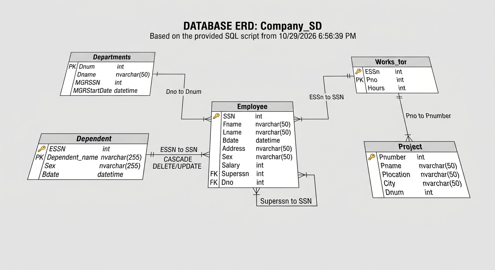
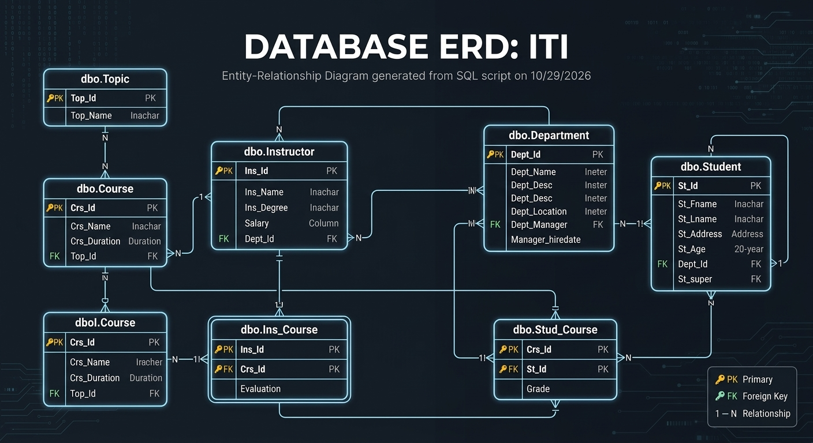

# SQL Server Practical Projects

## About This Repository

This repository documents my practical experience and continuous learning in Microsoft SQL Server.

It contains three relational databases that I use to practice, explore, and demonstrate SQL concepts, database development, and database administration.

## Databases

### 1. Company_SD

### 2. ITI

### 3. AdventureWorks

## Topics Covered

- Database Design and ERD
- DDL (CREATE, ALTER, DROP)
- DML (INSERT, UPDATE, DELETE)
- SELECT Queries
- Joins and Subqueries
- Aggregate Functions
- Constraints
- Views
- Stored Procedures
- User-Defined Functions
- Triggers
- Transactions
- Indexes
- Variables and Data Types

## Repository Structure

Each database has its own directory, containing organized SQL scripts grouped by topic.

## Purpose

The purpose of this repository is to document my hands-on SQL Server practice, experiments, problem-solving, and continuous improvement.
